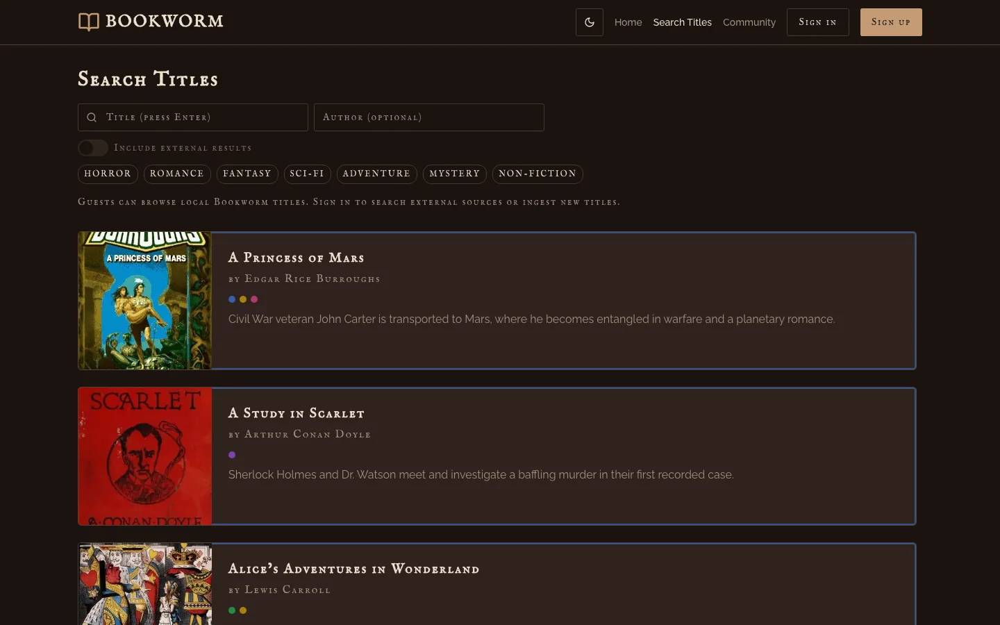
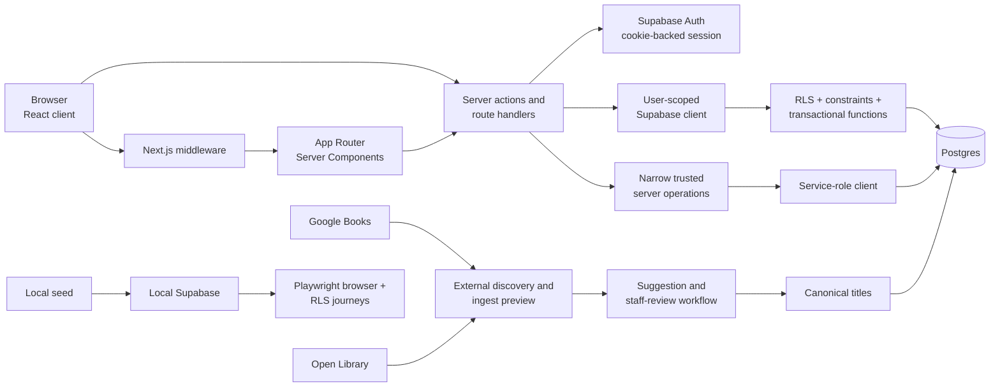

# Bookworm

[](https://github.com/Neetko/bookworm04/actions/workflows/ci.yml)

Bookworm is a full-stack reading community for discovering titles, keeping a useful reading record, and turning finished books into reviews, discussions, and club activity.

**Hosted application:** [bookworm04.vercel.app](https://bookworm04.vercel.app)

**Reproducible local showcase:** no Google OAuth credentials required

> Release note: the public endpoint exists, but the portfolio branch, database migrations, and hosted Google sign-in must be promoted and verified together before the URL is treated as evidence of the final showcase release. The local setup below is the current reproducible reference.



## Try Bookworm in three minutes

1. Open **Search Titles** and combine genre filters. Selecting more genres narrows the result to titles carrying every selected tag.
2. Open a title. Reviews and discussion remain readable to guests; contribution controls explain why sign-in and finished-reading state are required.
3. Sign in with the local fixture account, mark a title as read, and add a review or discussion post. Read state survives reloads.
4. Visit **Home** to see a populated following feed, then **Community** to compare open, approval-required, and invitation-only clubs.
5. Create a fresh account to exercise the real first-run path: every sign-up is sent through username, favorite-genre, and optional title-selection onboarding.

The local reviewer account is disposable fixture data:

```text
Email: demo@bookworm.test
Password: BookwormDemo!2026
```

These credentials work only after the local database reset described below. They are not published to or accepted by the hosted environment.

## What the project demonstrates

- **Catalog and discovery:** canonical titles, locally cached showcase covers, title/author search, and multi-genre AND filtering.
- **Reading record:** planned/current/finished lists, page or listening progress, and point-in-time diary entries.
- **Read-gated engagement:** public review and discussion reading, with rating, review, post, and like mutations unlocked only after finishing a title.
- **Community:** following activity, messages, notifications, reading clubs, writers' clubs, and open/approval/invite membership policies.
- **Metadata stewardship:** Google Books and Open Library discovery flows into a reviewed canonical catalog instead of silently overwriting local records.
- **Defense in depth:** capability-aware controls, authenticated and validated server actions, and independent Postgres row-level security.
- **Reproducibility:** deterministic Supabase fixtures, optimized local cover assets, unit tests, browser journeys, direct database-policy tests, and CI.

## Architecture



The important boundary is the database, not the visibility of a button. Normal user operations run with the reader's session and remain subject to RLS. Trusted credentials are limited to narrow server-only workflows such as controlled notification creation and staff metadata approval.

## Representative engineering decisions

### One canonical title model

Reviews, discussions, lists, progress, diary entries, and clubs all reference canonical `titles`. External source IDs, ISBN references, and editions are separate records. That prevents a Google/Open Library result from becoming a second product identity for the same work.

### Finished-list membership is the read signal

Moving a title into the finished list is the durable source of truth for read-gated actions. The interface uses that capability to explain locked controls, server actions check it again, and database policies reject direct bypass attempts.

### Club transitions are database transactions

Joining, applying, approving, inviting, accepting, declining, leaving, and removing run through narrow Postgres functions. Each function derives the current reader, checks club policy and request state, and updates membership, activity, request status, and in-app notifications atomically.

### The demo is data, not a second product

Runtime pages, actions, migrations, and authorization are shared with the maintained application. Demo-only differences are limited to deterministic local fixtures, optimized fixture cover files, and local email/password authentication. A fix that exists only in seed data is not considered complete.

## Local setup

### Prerequisites

- Node.js 22
- pnpm 10
- Docker with its daemon running
- [Supabase CLI](https://supabase.com/docs/guides/local-development/cli/getting-started)

Docker is expected for the local showcase because Supabase runs Auth, Postgres, Storage, and its supporting services in containers. Reviewers do not need a hosted database or a Google Cloud project.

### 1. Install dependencies

```bash
pnpm install --frozen-lockfile
```

### 2. Start and seed local Supabase

```bash
supabase start
supabase db reset --local
```

The reset replays all migrations and `supabase/seed.sql`. It creates 30 tagged titles, optimized local WebP covers, five active community profiles, a populated demo reader, and clubs covering all three membership policies.

`db reset --local` deletes **local** database data. Never run the reset or load the showcase seed against a remote project.

### 3. Configure the application

```bash
cp .env.example .env.local
supabase status -o env
```

Copy the values as follows:

| Supabase output | `.env.local` |
| --- | --- |
| `API_URL` | `NEXT_PUBLIC_SUPABASE_URL` |
| `ANON_KEY` | `NEXT_PUBLIC_SUPABASE_ANON_KEY` |
| `SERVICE_ROLE_KEY` | `SUPABASE_SERVICE_ROLE_KEY` |

Keep the service-role key server-side and out of Git. `DATABASE_URL` is required only for Drizzle commands. `GOOGLE_BOOKS_API_KEY` is optional; local catalog browsing remains available without it, while external discovery receives the provider's unauthenticated quota.

The template selects `NEXT_PUBLIC_AUTH_MODE=email`. Local email confirmation is disabled, so both the fixture login and fresh sign-up/onboarding work without an email service.

### 4. Run Bookworm

```bash
pnpm dev
```

Open [http://localhost:3000](http://localhost:3000).

To rebuild the committed showcase covers from their pinned Open Library records:

```bash
pnpm demo:covers
```

## Verification

Fast checks:

```bash
pnpm lint
pnpm typecheck
pnpm test
pnpm build
```

Clean local browser and database-policy verification:

```bash
pnpm test:e2e:local
```

That command resets only the local database before running deterministic journeys with one worker. The suite covers guest access, sign-up/onboarding, sign-in/out, read gating, progress/diary behavior, club membership lifecycles, notification boundaries, and direct RLS bypass attempts.

Hosted smoke tests are deliberately read-only and require an explicit URL:

```bash
PLAYWRIGHT_BASE_URL=https://your-deployment.example pnpm test:e2e:prod
```

The CI quality job builds the hosted Google-auth path. The local journey job uses disposable email/password fixtures.

## Hosted Google sign-in

Hosted builds use Google by default (`NEXT_PUBLIC_AUTH_MODE=google`, or leave the variable unset). Every deployment needs its own Supabase project and Google OAuth client, the Supabase callback URL in Google, and the application URL in Supabase's allowed redirect list.

See the [Supabase Google sign-in guide](https://supabase.com/docs/guides/auth/social-sign-in/auth-google) and [redirect URL guide](https://supabase.com/docs/guides/auth/redirect-urls). A Google consent screen left in testing mode or a missing redirect URL can make a healthy application appear broken. This is why local reproduction intentionally does not depend on OAuth.

## Project layout

| Area | Responsibility |
| --- | --- |
| `app/` | App Router pages, route handlers, and thin server-action entry points |
| `components/` | Reusable product and UI components |
| `lib/server/` | Authenticated domain services and database clients |
| `lib/` | Shared validation, parsing, matching, sanitization, and capabilities |
| `supabase/migrations/` | Deployment source of truth for schema, functions, constraints, and RLS |
| `supabase/seed.sql` | Local-only deterministic showcase data |
| `tests/unit/` | Fast business-rule and integration-helper tests |
| `tests/e2e/` | Browser journeys and direct local-Supabase policy tests |

`db/schema.ts` is kept in sync for typed schema tooling, while Supabase migrations are the deployment record.

## Honest limitations

- The hosted endpoint exists, but the final portfolio branch, schema version, and Google OAuth journey must be verified together before the showcase release is tagged.
- The 30-title catalog is a deterministic reviewer dataset, not a claim of production catalog scale.
- Google Books and Open Library availability and quotas are external dependencies; the local catalog remains usable when they are unavailable.
- Club ownership transfer, invitation auto-expiry, and a distinct ban/rejoin-cooldown model are not yet implemented.
- In-app lifecycle notifications are transactional, but email or push delivery would need a durable outbox and retry worker.
- Writer-club authoring has server/RLS coverage but still needs a dedicated browser journey.
- The preserved reader prototype is not a public route. Reading verified public-domain text from a canonical title page is a documented follow-up.

## Engineering documentation

- [Development log](DEVELOPMENT_LOG.md) — the single maintained history of problems, decisions, implementations, checks, and trade-offs.
- [Five-minute interview walkthrough](docs/interview-walkthrough.md) — product and code paths prepared for a technical conversation.
- [Critical journeys](docs/critical-journeys.md) — persona-level behavior and authorization contract.
- [Portfolio readiness roadmap](docs/portfolio-readiness-roadmap.md) — one-product delivery rule and release criteria.
- [Legacy and roadmap inventory](docs/legacy-and-roadmap-inventory.md) — intentionally removed or preserved historical work.
- [Public-domain reader roadmap](docs/roadmap/public-domain-reader.md) — planned reader requirements.

Historical notes under `docs/archive/` are unmaintained source material. They are retained for provenance, not as current setup or product documentation.
